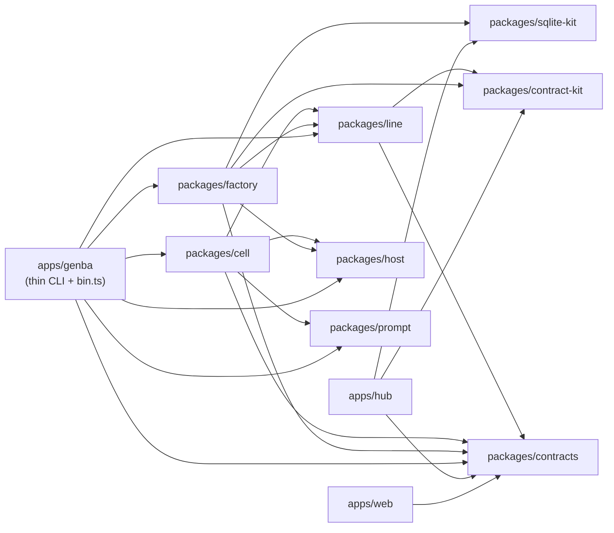

# Architecture

Monorepo layout, Option 1 single-binary packaging model, package boundaries, and dependency rules for `genba`. Terms: [README.md](./README.md#glossary). Runtime ownership: [boundaries.md](./boundaries.md).

## Packaging Model (Option 1: Single Binary + Layered Packages)

Rule: **`apps/` = deployable entrypoints** (never import another app's `src/`); **`packages/` = isolated runtime and domain libraries** enforced by `package.json` dependencies.

### Why Hono Factory Lives in `packages/factory`

Factory is a Hono HTTP/SSE server (`createApp()` -> `app.fetch` / `app.request()`), not a thin helper. Keeping it in `packages/factory` (instead of `apps/factory`) gives three properties at once:

1. **Single binary distribution**: `apps/genba` compiles (`bun build --compile`) into one `genba` binary covering CLI, Factory (`__daemon`), Cell (`__cell`), and `operator`.
2. **Zero-port `--once` mode**: `genba run --once` imports `@repo/factory/embedded` and calls Hono's `app.request()` in-process against `:memory:` SQLite — no extra binary, no TCP port, same HTTP contracts.
3. **Hard runtime isolation**: `packages/factory` and `packages/cell` cannot import each other; if a standalone `genba-factory` binary is ever wanted later, it is a 10-line wrapper calling `@repo/factory/start`.

## Workspace Layout

### `apps/` (3 Deployables)

| App | Artifact | Responsibility |
| :--- | :--- | :--- |
| `apps/genba` | Single compiled `genba` binary | Thin shell: `bin.ts` lazy dispatch, human CLI (`init`, `doctor`, `start`, `scale`, `stop`, `run`, `import`, `queue`, `order`, `incident`, `watch`), `genba operator` verb client, built-in init templates, `--once` composition |
| `apps/hub` | Optional `genba-hub` server | Standalone multi-factory Hono server: Factory registry, read projections, SSE fan-out, command outbox. Never embedded in `genba` |
| `apps/web` | Optional supervisor Web UI | Single frontend app targeting `apps/hub` or local Factory loopback (no `web` vs `web-demo` split) |

### `packages/` (Layered Modules)

| Layer | Package | Responsibility |
| :--- | :--- | :--- |
| **0: Kits & OS** | `packages/contract-kit` | Shared Zod contract and HTTP reply helpers |
| **0: Kits & OS** | `packages/sqlite-kit` | `bun:sqlite` + Drizzle client and embedded migrations |
| **0: Kits & OS** | `packages/prompt` | Typed frontmatter + Handlebars renderer (`stage: sync`, `stage: runtime`) |
| **0: Kits & OS** | `packages/host` | OS primitives & ports: `fs`, `lock`, `pid-file`, `process/spawn`, `process/self`, `clock`, `herdr-workspaces` |
| **1: Shared Domain** | `packages/contracts` | Unified wire schemas (`orders`, `jobs`, `incidents`, `operator`, `factory`, `hub`, `enums`) |
| **1: Shared Domain** | `packages/line` | Pure blueprint & shared conventions: `line`, `stations`, `order`, `manifest`, `branch`, `cells`, `runtime-paths`, `timeline` (zero IO) |
| **2: Runtimes** | `packages/factory` | Local control plane: Hono server (`app.ts`, `start.ts`), `embedded.ts`, Drizzle SQLite store, pure scheduler (`domain/schedule.ts`), procedures, Cell supervisor & cell homes |
| **2: Runtimes** | `packages/cell` | Worker runtime: Cell loop, Order worktree lifecycle & changeover hooks, stations (`operator`, `inspection`, `mechanic`, `deliver`, `escalate`), `ROLE.md` guards, adapters (`git`, `forge`, `runners`, `operator-endpoint`), read-only `@repo/cell/probes` |
| **Tooling** | `packages/nitpick`, `packages/eslint-config`, `packages/typescript-config` | Optional AI rules/skills checker (never imported by `apps/genba`, `factory`, or `cell`) and shared configs |

## Package Dependency Graph



### Forbidden Edges (Enforced by `package.json`)

- `packages/factory` **never** imports `packages/cell`, `packages/prompt`, `git`, `forge`, or AI runners.
- `packages/cell` **never** imports `packages/factory` or `packages/sqlite-kit`.
- `packages/line` **never** imports `packages/host`, `packages/sqlite-kit`, `packages/factory`, or `packages/cell` (pure domain, zero IO).
- `apps/hub` **never** imports `packages/factory`, `packages/cell`, or `packages/line`.
- `apps/web` **never** imports any server or runtime package (only `packages/contracts`).
- `apps/genba` **never** imports `packages/sqlite-kit` or `packages/nitpick`.

## Inside Each Module

### `packages/factory`

```text
packages/factory/src/
├── domain/                 # Pure scheduling & retry/escalation rules (schedule.ts)
├── db/                     # Drizzle schema, client, embedded SQLite migrations
├── application/
│   ├── core/               # context, errors, procedure, lines loader, pagination
│   ├── ports/              # store.port, auth.port, event-bus.port
│   ├── cells/              # supervisor.ts (kill-before-requeue), cell-homes.ts
│   ├── orders/             # apply-decision, requeue-job, settle-job
│   └── procedures/         # cells/, factory/, incidents/, jobs/, orders/
├── adapters/
│   ├── auth/               # token-auth.adapter.ts
│   ├── memory/             # event-bus.adapter.ts (in-process SSE bus)
│   ├── sqlite/             # store.ts
│   └── hono/               # routes, middlewares, error-handlers
├── config.ts               # Limits and timings
├── app.ts                  # createApp(): Hono router + middleware
├── start.ts                # startFactory(): loopback Bun.serve + supervisor
└── embedded.ts             # createEmbeddedFactory(): :memory: SQLite + app.request()
```

- Server layout follows `software-factory/apps/hq`: contract in `@repo/contracts` (input and output checked) -> procedure -> thin route with `honoAdapter`.
- Procedures never touch Hono; they return `{ code }` or throw `BaseError`. Only `events.route.ts` streams.
- Unlike HQ: procedures use `StorePort`, not Drizzle directly.
- Public exports: `start`, `embedded`. `cellVerb` and `selfCommand` come from the app.
- Layers inside the package are ESLint-enforced (`packages/factory/eslint.config.mjs`): `domain/` pure; `application/` and `db/` never import Hono or adapters.
- HTTP tests: `packages/factory/test/blackbox/`, via `app.request()`.

### `packages/cell`

Not extracted yet: this code is in `apps/genba/src/` (`runtimes/cell`, `adapters`, `ports`). Until then, ESLint (`apps/genba/eslint.config.mjs`) keeps `cell/`, `cli/`, `operator/`, and `domain/` off `@repo/factory`.

```text
packages/cell/src/
├── domain/                 # Pure role parsing, guidance, pr-body, quota helpers
├── ports/                  # git, forge, runner, operator, loopback-api
├── adapters/
│   ├── git/                # worktree & branch operations
│   ├── forge/              # gh / glab router + auth/PR probes
│   ├── runners/            # claude, codex, copilot, cursor, opencode, antigravity, herdr, headless
│   ├── operator-endpoint/  # per-job loopback server for `genba operator`
│   └── http/               # loopback-api client talking to Factory
├── runtime/
│   ├── loop.ts             # Claim -> run -> archive -> report
│   ├── worktree.ts         # Order worktree lifecycle & changeover hooks
│   ├── station-operator.ts # Agent run + operator verbs
│   ├── station-inspection.ts
│   ├── station-mechanic.ts
│   ├── station-deliver.ts  # PR, or Draft PR + Andon Issue
│   ├── guard-validator.ts  # Live ROLE.md guards
│   ├── prompt.ts           # ROLE.md footer: inputs, outputs, verbs
│   └── main.ts             # `genba __cell` composition root
└── probes.ts               # Narrow read-only host probes for CLI `init` / `doctor`
```

### `apps/genba` (Thin Single-Binary Shell)

```text
apps/genba/src/
├── builtin/                # Embedded init templates: lines/*.yml & roles/*/ROLE.md (`with { type: 'text' }`)
├── domain/                 # detect-project.ts, exit-codes.ts
├── operator/               # `genba operator <verb>` zero-state client + exit mapping
├── standalone/             # `genba run --once` wiring (@repo/factory/embedded + @repo/cell)
├── cli/                    # Human commands (init, doctor, start, scale, stop, run, import, queue, order, incident, watch)
└── bin.ts                  # Dynamic `await import(...)` dispatch keeping `genba operator` fast and light
```

- **Dynamic dispatch**: `bin.ts` uses `switch` + dynamic `await import(...)` so `genba operator` never loads Factory, Drizzle, SQLite, or Cell adapters.
- **Execution vs. read-only host probes**:
  - Mutating execution (`spawnRunner`, worktree writes, `publishPr`, `upsertAndonIssue`) -> `packages/cell` runtime only.
  - Read-only host probes (`probeRunners`, `git.remoteUrl`, `forge.checkAuth`, `forge.getPrStatus`) -> exported via `@repo/cell/probes` for `apps/genba` CLI (`init`, `doctor`).

### `apps/hub` (Phase 5 - Optional)

Standalone `genba-hub` Hono binary/server. Zero step/retry/Mechanic state machines.

```text
apps/hub/src/
├── adapters/
│   ├── db/                 # Read projections + outbox table (@repo/sqlite-kit)
│   └── hono/               # HTTP + SSE fan-out
├── core/                   # procedure.ts, auth (hub_join -> hub_session, web_session), errors
└── procedures/             # sync-snapshot, pull-outbox, enqueue-command, list-fleet, list-orders, get-oee
```

### `apps/web` (Phase 6 - Optional)

Vertical-slice EDA architecture (`gon-stack` pattern), targeting `hub` or local Factory loopback.

```text
apps/web/src/
├── core/                   # Router, shell, SSE client, theme tokens
├── libs/                   # Generic EDA bus / store helpers
├── shared/                 # Reusable UI primitives, error/empty states, API client
└── modules/                # fleet, orders, incidents, metrics
    └── <module>/           # configuration/, domain/, core/, integration/, presentation/
```

- `presentation/` reads state and calls `core/facade` only.
- `integration/` owns DTO mappers and HTTP/SSE calls.
- `domain/` and `core/` stay UI-agnostic.
