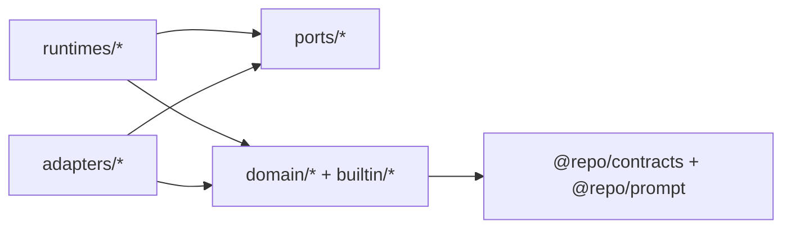

# Architecture

Monorepo layout, runtime boundaries, and import rules for `genba`. Terms: [README.md](./README.md#glossary).

## Workspace Boundary

Apps never import another app's `src/`. Shared wire schemas and primitives live in `packages/`.

- `packages/contract-kit` - Zod contract and reply helpers
- `packages/contracts` - Unified wire schemas (`orders`, `jobs`, `incidents`, `operator`, `hub`)
- `packages/sqlite-kit` - `bun:sqlite` + Drizzle DB and embedded migrations
- `packages/prompt` - Frontmatter + Handlebars renderer (`stage: sync`, `stage: runtime`)
- `packages/nitpick` - Optional AI rules/skills checker (never imported by `apps/genba`)
- `apps/genba` - Standalone `genba` binary (`cli`, `daemon`, `cell`, `operator`)
- `apps/hub` - Optional standalone `genba-hub` binary/server (separate binary, never embedded in `genba`)
- `apps/web` - Optional single supervisor Web UI (no `web` vs `web-demo` split)

## Inside `apps/genba`

Hexagonal core (`domain/`, `builtin/`, `ports/`, `adapters/`) separated from 4 strict process runtimes (`runtimes/`).

```text
apps/genba/src/
├── domain/                  # Pure rules, zero IO (manifest, line, role, order, schedule, pr-body, detect-project)
├── builtin/                 # Embedded lines/*.yml & roles/*/ROLE.md (`with { type: 'text' }`)
├── ports/                   # Narrow app-owned interfaces (clock, fs, process, git, forge, runner, operator, store, loopback-api)
├── adapters/                # Concrete implementations (sqlite, fs, git, forge, runners, process, operator-endpoint, operator-client, http)
├── runtimes/                # each main.ts is that runtime's composition root
│   ├── daemon/              # `genba __daemon` (127.0.0.1:7072) - only runtime touching adapters/sqlite
│   │   ├── core/            # context.ts, errors.ts
│   │   ├── procedures/      # One file per use-case (import-orders, claim-job, complete-job, requeue-job...)
│   │   ├── supervisor.ts    # Spawns/scales/kills Cells (kill-before-requeue invariant)
│   │   ├── events.ts        # In-process bus behind SSE
│   │   └── server.ts        # `Bun.serve` routes -> procedures, auth
│   ├── cell/                # `genba __cell` - 1 job, 1 worktree, disposable
│   │   ├── loop.ts          # Claim -> run -> report
│   │   ├── worktree.ts      # Worktree lifecycle & setup
│   │   ├── station-operator.ts     # Agent run + operator verbs
│   │   ├── station-inspection.ts   # Repo checks
│   │   ├── station-mechanic.ts     # Triage
│   │   ├── station-deliver.ts      # PR, or Draft PR + Andon Issue
│   │   ├── guard-validator.ts      # Live ROLE.md guards
│   │   └── prompt.ts        # ROLE.md footer: inputs, outputs, verbs
│   ├── operator/main.ts     # `genba operator <verb>` - zero-state; client injected by bin.ts
│   └── cli/                 # Human commands (init, doctor, start, scale, stop, run, import, queue, order, incident, watch)
└── bin.ts                   # Dynamic `await import(...)` dispatch, keeps `genba operator` light
```

### Dependency & Host-Probe Rules



- **Execution vs. read-only host probes**:
  - Mutating execution (`spawnRunner`, worktree writes, `publishPr`, `upsertAndonIssue`) -> `runtimes/cell/` only.
  - Read-only host probes (`probeRunners`, `git.remoteUrl`, `forge.checkAuth`, `forge.getPrStatus`) -> allowed in `runtimes/cli/` (for `init`, `doctor`) and `runtimes/cell/`.
- **Dynamic dispatch**: `bin.ts` uses `switch` + dynamic `await import(...)` so `genba operator` never loads daemon, Drizzle, or SQLite.
- **State machine**: scheduling decisions are pure (`domain/schedule.ts`); daemon only persists them. Delivery, Mechanic, and escalation are jobs, so only Cells call `gh` / `glab`.
- **ESLint-enforced boundaries** (`apps/genba/eslint.config.mjs`):
  - `src/domain/**` forbids `../adapters/**`, `../runtimes/**`
  - `src/runtimes/operator/**` forbids `../../adapters/**`, `../daemon/**`, `../cell/**`
  - `src/runtimes/cell/**` forbids `**/adapters/sqlite/**`, `../daemon/**`
  - `src/runtimes/cli/**` forbids `**/adapters/sqlite/**`

## Inside `apps/hub` (Phase 5 - Optional)

Standalone `genba-hub` binary/server. Zero step/retry/Mechanic state machines.

```text
apps/hub/src/
├── adapters/
│   ├── db/            # Read projections + outbox table (@repo/sqlite-kit)
│   └── hono/          # HTTP + SSE fan-out
├── core/              # procedure.ts, auth (hub_join -> hub_session, web_session), errors
└── procedures/        # sync-snapshot, pull-outbox, enqueue-command, list-fleet, list-orders, get-oee
```

## Inside `apps/web` (Phase 6 - Optional)

Vertical-slice EDA architecture (`gon-stack` pattern), targeting `hub` or local `daemon` loopback.

```text
apps/web/src/
├── core/              # Router, shell, SSE client, theme tokens
├── libs/              # Generic EDA bus / store helpers
├── shared/            # Reusable UI primitives, error/empty states, API client
└── modules/           # fleet, orders, incidents, metrics
    └── <module>/      # configuration/, domain/, core/, integration/, presentation/
```

- `presentation/` reads state and calls `core/facade` only.
- `integration/` owns DTO mappers and HTTP/SSE calls.
- `domain/` and `core/` stay UI-agnostic.
