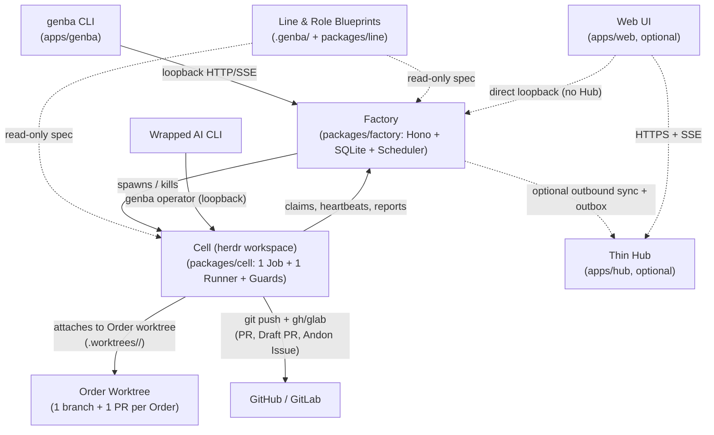

# Runtime & Domain Boundaries

Strict ownership across `genba` runtimes and work entities. Terms: [README.md](./README.md#glossary).

## Two Orthogonal Axes

Separate **where things run** (infrastructure) from **what is being built** (work):

```text
Infrastructure Axis                         Work Axis
-------------------                         ---------
Hub (0..1, optional, multi-repo)            Line (static YAML blueprint, zero state)
 +-- Factory (1 per repo, Hono + SQLite)    Plan (optional batch of 1..N Orders via planId)
      +-- Cell (0..N, herdr workspace)       +-- Order (OWNS 1 branch + 1 worktree + 1 PR)
                                                  +-- Step (1 per station in Line)
                                                       +-- Job (1 attempt) --claimed by--> Cell
```

## Worktree & Workspace Ownership

- **Cell = `herdr` workspace (`cell-1..N`)**: reusable worker slot (1 process, 1 `herdr` workspace, 1 timeline). Runs 1 Job at a time, then picks the next Job. Never owns a worktree for its lifetime.
- **Order = git worktree + branch + PR**: `.worktrees/<slug>/` on branch `genba/<slug>`. Created on the Order's first station, reused across stations (`build -> quality-gate -> audit -> deliver`) even across different Cells, reset only on `restart_from_scratch`, removed on `deliver`.
- **Line != worktree**: a Line (`fast`, `standard`, `feature`) is a static recipe. Multiple Orders run on the same Line concurrently; owning a worktree per Line would collide.
- **Plan != worktree**: a Plan groups `1..N` Orders (`planId`), which may run in parallel or stack via `parentSlug`; each Order owns its own branch, worktree, and PR.
- **Job != worktree**: a Job is 1 execution attempt of 1 Step; all Jobs of an Order share that Order's worktree so commits and diffs flow between stations.

## Ownership Matrix

| Entity / Runtime | Kind & Cardinality | Owns (Source of Truth) | Never Owns | Talks To | Auth / Trust |
| :--- | :--- | :--- | :--- | :--- | :--- |
| **Repo Manifest & Lines** (`.genba/`) | Static config (`N` Lines, `N` Roles per repo) | Project settings (`config.json`), Line blueprints (`lines/*.yml`), Role contracts (`roles/*.md`) | Runtime state, DB, secrets, worktrees | Read-only input to Factory, Cell, CLI | Committed in git (no secrets) |
| **Hub** (`apps/hub`, optional) | Remote aggregator (`1` Hub : `N` Factories) | Outbound Factory registry, read projections (fleet, orders, incidents + forge URLs, OEE), SSE fan-out, command outbox | Scheduling, retries, Mechanic logic, repo SQLite, worktrees, `git`, `gh`/`glab`, runners | Inbound HTTPS from Factories & Web UI | `hub_join` -> `hub_session`; `web_session` |
| **Factory** (`packages/factory`, `genba __daemon`, `127.0.0.1:7072`) | Local control plane (`1` Factory : `1` repo) | Local SQLite DB (`orders`, `order_steps`, `jobs`, `incidents`), DAG & station/retry/escalation scheduler, Cell supervision/scaling, Hono HTTP/SSE API, embedded `:memory:` mode (`--once`), optional Hub sync | Running AI CLIs, mutating worktrees, `git`, `gh`/`glab`, `ROLE.md` execution | Loopback HTTP/SSE (CLI, Cells, Web UI); optional outbound HTTPS to Hub | CLI bearer in `.genba-local/cli-token` (0600); ephemeral bearer per Cell; rejects `Origin` and foreign `Host` |
| **Cell** (`packages/cell`, `genba __cell`) | Disposable worker slot (`0..N` per Factory; `1` active Job) | `herdr` workspace slot (`cell-<n>`), Order worktree checkout & changeover hooks during Job, running 1 station (`operator` / `inspection` / `mechanic` / `deliver` / `escalate`), `ROLE.md` rendering & live guards, `git` + `ForgePort` (`gh`/`glab`) | SQLite writes, queue ordering, retry/escalation decisions, multi-job concurrency, Hub credentials | Factory loopback; child AI runner (loopback); `git` / GitHub / GitLab | Slot name `cell-<n>` + in-memory bearer |
| **Operator Client** (`genba operator`) | Zero-state CLI inside station | Verb parsing (`done`, `verdict`, `block`, `context`, `read`, `incident`), single POST to Cell loopback | State transitions, DB/Factory/Hub/Forge calls | Cell loopback (`$GENBA_OPERATOR_URL`) | Per-job `$GENBA_CYCLE_TOKEN` |
| **Genba CLI** (`apps/genba`) | Human entrypoint & single-binary shell | Arg validation, `init` auto-detection, `doctor` read-only probes, Factory auto-start, `--once` wiring, table/JSON output | Direct SQLite writes, scheduling, mutating execution | Factory loopback (`127.0.0.1:7072`); read-only host probes | CLI bearer from `.genba-local/cli-token` |
| **Web UI** (`apps/web`, optional) | Supervisor dashboard | Fleet, orders, Andon incidents, OEE views, BFF session/CSRF | Direct DB access, process spawning, execution decisions | Hub or local Factory loopback | `web_session` / loopback |

One Factory per repo, state in `<repo>/.genba-local/`. Second repo at the same time needs another `GENBA_PORT`.

## Topology



## Seam Contracts

1. **Hub <-> Factory (Visibility vs. Control)**: Factory is autonomous offline and owns every state transition. Hub stores read projections and queues remote commands (`hubCommand` outbox) that Factory validates and executes locally.
2. **Factory <-> Cell (Decide vs. Execute)**: Factory decides what runs next (`domain/schedule.ts`), persists state, and supervises Cell processes. Cell executes one assigned Job in isolation and reports a structured `JobOutcome`.
3. **Line -> Factory & Cell (Spec vs. Runtime)**: Line is pure config/domain schema with zero IO. Factory reads Line to schedule stations and retries; Cell reads Line to execute the assigned station.
4. **Standalone `--once` (In-Process Seam)**: `genba run <order.md> --once` keeps the exact same Factory/Cell boundary without a socket or daemon process — `packages/factory` exposes `createEmbeddedFactory()` using `:memory:` SQLite and Hono's `app.request()` in-process for one temporary Cell (`once-<hex>`).

## Prompt & Standards Split

- **`packages/prompt`** (`stage: runtime` / `stage: sync`): single Handlebars + typed frontmatter compiler.
  - `packages/cell` renders role `.md` files (`stage: runtime`) from `.genba/roles/`; init templates stay embedded in `apps/genba` via `with { type: 'text' }`.
  - Optional `packages/nitpick` renders parameterized `rules/*.md` docs & fix hints (`stage: sync`); plain user docs stay untouched.
- `apps/genba`, `packages/factory`, and `packages/cell` **never** depend on `packages/nitpick`.

## Hard Invariants

1. **No genba secrets in children**: of `GENBA_*`, agents get only `$GENBA_OPERATOR_URL` and `$GENBA_CYCLE_TOKEN`; setup and checks get none. This is not a sandbox: agents run as your user, keep other env vars, and can read local files ([issue](../issues/agents-can-reach-daemon-token.md)).
2. **Kill before requeue**: Factory confirms exit of Cell process and its runner process group before reassigning a Job.
3. **External caps**: Retry counts and model escalation are enforced by Factory outside the LLM.
4. **Offline autonomy**: Hub outage never stalls or blocks local Cells; state syncs on reconnect.
5. **Non-fatal forge escalation**: If `gh`/`glab` fails during Andon reporting, the Incident still records locally with a warning.
