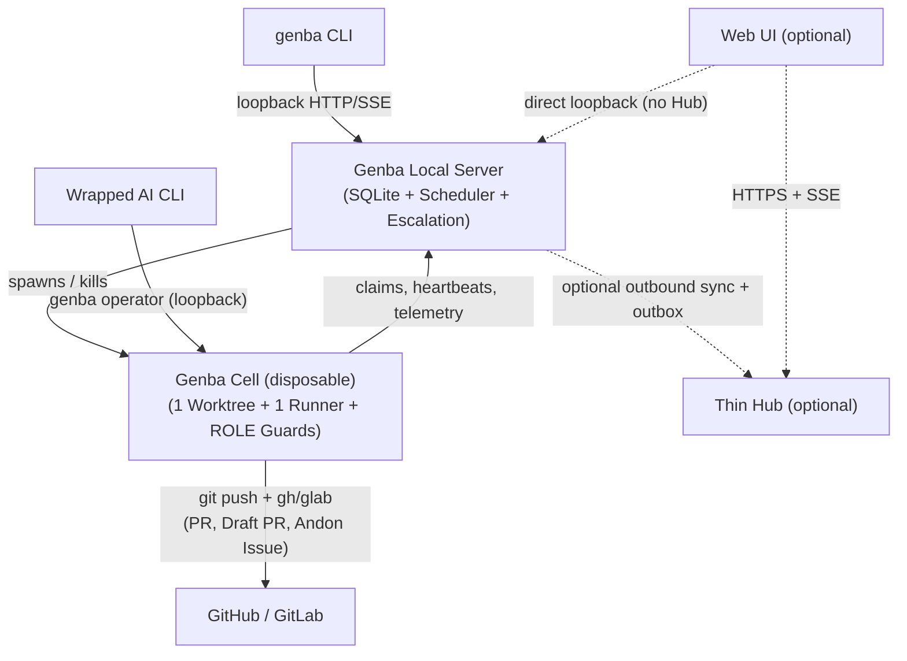

# Runtime Boundaries

Strict ownership across `genba` runtimes. Terms: [README.md](./README.md#glossary).

## Ownership Matrix

| Runtime | Owns (Source of Truth) | Never Owns | Talks To | Auth / Trust |
| :--- | :--- | :--- | :--- | :--- |
| **Repo Manifest** (`.genba/config.json`) | Repo-unique hooks: `project`, `git`, `workspace.setup`, `checks`, `context`, optional `tiers` | Lines, `ROLE.md`, secrets, runtime state | Read by CLI & Cell | Committed in git (no secrets) |
| **Genba Local Server** (`genba __daemon`, `127.0.0.1:7072`) | Local SQLite DB, scheduling, retries, model escalation, Cell supervision/scaling, SSE stream, optional Hub sync | Running LLM CLIs in-process, mutating worktrees, calling `gh`/`glab` | Loopback HTTP/SSE; optional outbound HTTPS to `hub` | Holds optional `hub_session`; issues ephemeral bearer per Cell |
| **Genba Cell** (`genba __cell`) | 1 active Job, 1 worktree (`.worktrees/<slug>/`), `.cell/<step>/`, spawning 1 runner/inspection, live `ROLE.md` guards, `git` + `ForgePort` (`gh`/`glab`) | SQLite writes, `hub` credentials, queue ordering, multi-job concurrency | Local Server loopback; child runner; git/forge | Ephemeral `cell-<hex>` + in-memory bearer |
| **Operator Client** (`genba operator`) | Agent verb parsing (`done`, `verdict`, `block`, `context`, `read`, `incident`), single POST to Cell loopback | State transitions, DB/Hub/Forge calls | Cell loopback (`$GENBA_OPERATOR_URL`) | Per-job `$GENBA_CYCLE_TOKEN` |
| **Genba CLI** (`genba`) | Arg validation, `init` auto-detection, daemon auto-start, table/JSON output | Direct SQLite writes, scheduling, runner spawning | Local Server (`127.0.0.1:7072`) | Local loopback |
| **Hub** (`apps/hub`, optional) | Outbound Genba registry, read projections (fleet, orders, issues + forge URLs, OEE), SSE fan-out, command outbox | Step/retry/Mechanic state machines, worktrees, git, `gh`/`glab`, runners | Inbound HTTPS from Genba & Web UI | `hub_join` -> `hub_session`; `web_session` |
| **Web UI** (`apps/web`, optional) | Supervisor views (fleet, orders, Andon issues, OEE), BFF session/CSRF | Direct DB access, process spawning, execution decisions | `hub` or local Genba loopback | `web_session` / loopback |

## Topology

## Prompt & Standards Split

- **`packages/prompt`** (`stage: runtime` / `stage: sync`): single Handlebars + typed frontmatter compiler.
  - `apps/genba` renders built-in `.md` `ROLE.md` files (`stage: runtime`) embedded via `with { type: 'text' }`.
  - Optional `packages/nitpick` renders parameterized `rules/*.md` docs & fix hints (`stage: sync`); plain user docs stay untouched.
- `apps/genba` **never** depends on `packages/nitpick`.

## Hard Invariants

1. **Zero privilege leakage**: LLM agents only see `$GENBA_OPERATOR_URL` and ephemeral `$GENBA_CYCLE_TOKEN`.
2. **Kill before requeue**: Local Server confirms Cell OS process exit before freeing/reassigning a worktree.
3. **External caps**: Retry counts, and model escalation are enforced outside the LLM.
4. **Offline autonomy**: Hub outage never stalls or blocks local Cells; state syncs on reconnect.
5. **Non-fatal forge escalation**: If `gh`/`glab` fails during Andon reporting, the Incident still records locally with a warning.
